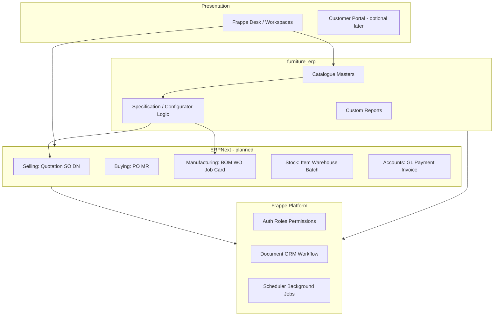

# Furniture ERP — Architecture

## Purpose

Furniture ERP is a Frappe application that extends **ERPNext** (when installed) for made-to-order and catalogue-driven **furniture manufacturing and delivery**. It adds a **product foundation catalogue** (families, materials, finishes, specifications) and furniture-specific process hooks on top of standard selling, buying, manufacturing, stock, and accounting.

**Current state (M0):** Only Frappe 17 + `furniture_erp` 0.0.1 scaffold. ERPNext is not installed. This document describes **target** architecture and **as-built** constraints.

## Design principles (Master Build Prompt Part C — invariants)

| ID | Invariant |
|----|-----------|
| INV-C-01 | **ERPNext is the system of record** for inventory quantities, valuation, and accounting entries once installed. |
| INV-C-02 | **One logical SKU** per sellable Item; configurators resolve to Item + BOM, not parallel shadow stock. |
| INV-C-03 | **Catalogue masters** (family, material, finish, specification) are maintained in `furniture_erp` and linked to ERPNext Items/BOMs. |
| INV-C-04 | **Submitted documents are immutable**; changes use cancel/amend or revision DocTypes per ERPNext pattern. |
| INV-C-05 | **Role-based access**; no business logic security solely in the client. |
| INV-C-06 | **India GST** compliance path via ERPNext + India compliance configuration (assumed default jurisdiction). |
| INV-C-07 | **Audit trail** via Frappe versions, comments, and standard GL/stock ledgers. |
| INV-C-08 | **Integrations** are idempotent and logged (see integration-register.md). |

## Logical layers

## Deployment topology

| Component | Location |
|-----------|----------|
| Bench | `/home/abhishek-jangir/carpenter_erp` |
| App package | `apps/furniture_erp` |
| Site config | `sites/carpenter` |
| Assets | `sites/assets/` (Frappe build) |
| Background workers | Bench `redis_queue`, `schedule` (standard) |

## Module map (Frappe)

| Module | Responsibility |
|--------|----------------|
| **Furniture_erp** (current) | Catalogue, settings, furniture-specific DocTypes and reports |
| **ERPNext modules** (after install) | CRM, Selling, Buying, Stock, Manufacturing, Accounts, Projects (as needed) |

Rename display module to **Furniture ERP** in UI when customising workspaces (cosmetic; `modules.txt` today shows `Furniture_erp`).

## Data ownership

| Domain | Owner (target) |
|--------|----------------|
| Product family / aesthetic taxonomy | `furniture_erp` |
| Material & finish libraries | `furniture_erp` + Item (raw/semi-finished) in ERPNext |
| Dimensional / attribute specifications | `furniture_erp` |
| Sellable SKU, price list, tax template | ERPNext Item + Pricing Rule |
| BOM, routing, capacity | ERPNext Manufacturing |
| On-hand stock | ERPNext Stock Ledger |
| AR/AP, GST vouchers | ERPNext Accounts |

## Extension mechanisms

| Mechanism | Use |
|-----------|-----|
| Custom DocTypes | Catalogue masters (M1–M2) |
| Custom fields on ERPNext DocTypes | Link Quotation Line → Furniture Specification (later milestone) |
| `doc_events` / controller overrides | Validate spec ↔ BOM, auto-create Item variants (guarded) |
| Client scripts | UX for configurators only; server validates |
| Fixtures | Roles, custom fields, property setters (versioned) |
| Patches | Data migration between milestones |

Hooks file today: no active `doc_events`, `fixtures`, or `required_apps`. **Recommendation:** set `required_apps = ["erpnext"]` in `hooks.py` after ERPNext install (M0.5 gate).

## Security architecture

- Authentication: Frappe session / API keys.  
- Authorisation: Role Profile + DocType-level permissions (see role-permission-matrix.md).  
- Multi-company: standard ERPNext Company model when enabled.

## Non-goals (M0)

- Microservices or separate API backend.  
- Replacing ERPNext stock or GL with custom tables.  
- Real-time CNC/shop-floor MES (optional future integration).

## Related documents

- [standard-vs-custom-doctype-matrix.md](./standard-vs-custom-doctype-matrix.md)  
- [accounting-stock-design.md](./accounting-stock-design.md)  
- [implementation-plan.md](./implementation-plan.md)