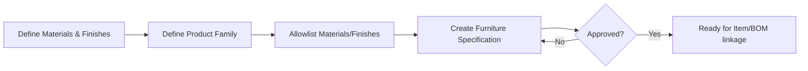
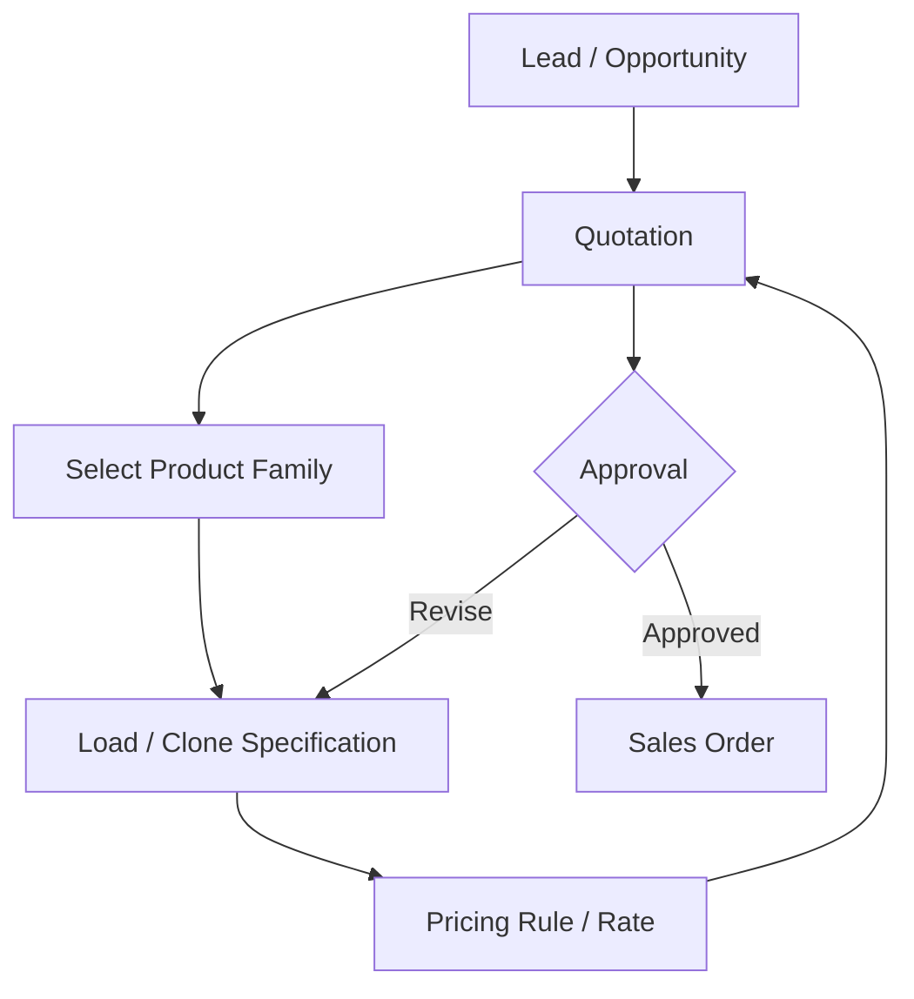
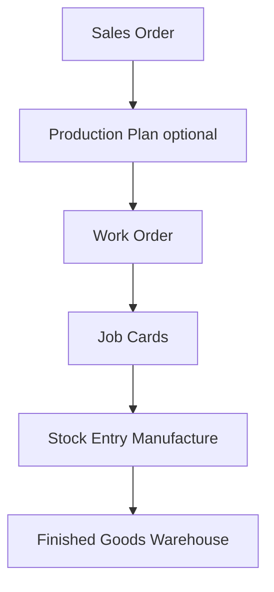
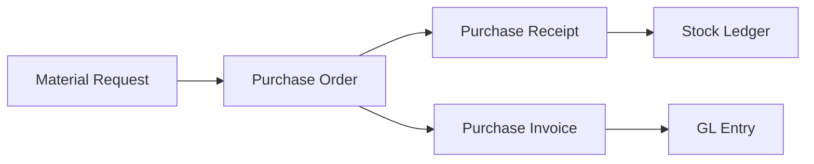
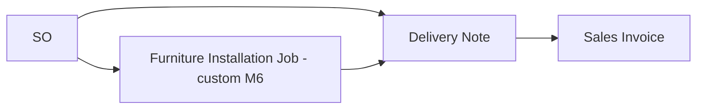

# Process Flows

End-to-end processes for Furniture ERP. **Standard ERPNext steps are dashed until ERPNext is installed.**

## 1. Catalogue maintenance (M1–M2 — no ERPNext dependency)

**Actors:** Catalogue Manager, Designer.  
**Output:** Approved `Furniture Specification` linked to family and materials.

## 2. Lead to quotation (target — ERPNext blocked)

**Standard DocTypes:** Lead, Opportunity, Quotation, Sales Order. **Status:** Blocked.

## 3. Sales order to production (target)

**Depends on:** Item, BOM, Work Order. **Status:** Blocked.

## 4. Procurement for materials

**Status:** Blocked.

## 5. Delivery and installation

Installation DocType is **planned**; DN/SI are ERPNext.

## 6. Specification revision

1. Designer sets spec to **In Review**.  
2. Engineering validates dimensions vs family rules.  
3. Manager approves → status **Approved**; prior version **Obsolete** on amend.  
4. Linked Quotation/SO (future) flagged for re-pricing if spec changes.

See [workflow-matrix.md](./workflow-matrix.md).

## 7. GST billing (India — assumed)

1. Sales Invoice with HSN from Item / Material master.  
2. Tax templates per place of supply.  
3. e-Invoice / e-Way per compliance app (**TBD** at ERPNext install).

## Process ↔ milestone map

| Process | First milestone |
|---------|-----------------|
| Catalogue maintenance | M1–M2 |
| ERPNext company & masters | M0.5 |
| Quotation with spec | M4 |
| BOM / WO | M5 |
| Procurement | M5 |
| Installation | M6 |
| Management dashboards | M7–M8 |